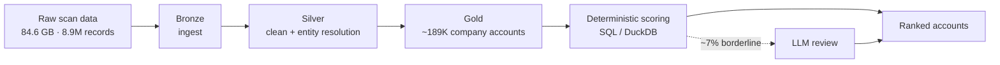

  

<table>
  <tr>
    <td width="170" align="center" valign="top">
      
       
      <b>Parimala Sri Sikhakolli</b>
    </td>
    <td valign="top">
      <h3>Hi, I'm Parimala Sri 👋</h3>
      

        <strong>Data Engineer with 1.5 years of experience</strong> building and optimizing production ETL/ELT pipelines with
        <strong>SQL, Informatica IICS/IDMC, Snowflake, AWS S3 and AWS Glue</strong>. I integrate heterogeneous enterprise sources, implement full,
        incremental and CDC-based processing, and automate data workflows so that data is dependable and decision-ready.
      

      <ul>
        <li>🏢 <strong>Jr Associate Developer – Data Engineer at 3M</strong> (Apr 2025 – present)</li>
        <li>☁️ Previously <strong>Data Engineer Intern at Amazon</strong> (PySpark, SQL, S3, Redshift)</li>
        <li>🎓 B.Tech in Computer Science — CGPA 9.2/10, Gayatri Vidya Parishad</li>
        <li>🤖 Exploring AI engineering and practical LLM applications</li>
      </ul>
    </td>
  </tr>
</table>

## Impact at a glance

| ⚡ Pipeline speed-up | 🔌 Source systems | 👁️ Views orchestrated | ⏱️ Manual effort saved |
| :---: | :---: | :---: | :---: |
| **90+ min → ~20 min** Apache Iceberg pipeline SLA | **6+** enterprise sources in production | **50+** Snowflake views via Taskflows | **~2 hrs / week** through workflow automation |

## Technical toolkit

**Languages** 

**Data warehousing & big data** 

**Data integration & ETL** 

**Cloud** 

**Modeling & practices** 

**Tools** 

## Experience

### 3M — Jr Associate Developer, Data Engineer
*Apr 2025 – present*

- Cut an **Apache Iceberg pipeline SLA from 90+ minutes to ~20 minutes** using merge-on-read and S3-based processing optimizations.
- Built production **ELT pipelines** with Informatica IICS/IDMC, SQL, Snowflake and AWS across **6+ enterprise source systems**, supporting full, incremental and CDC loads.
- Engineered **AWS Glue / Spark** pipelines for heterogeneous sources, feeding downstream Snowflake analytics.
- Implemented parameter-driven processing and **hard/soft-delete logic** to keep source-to-Snowflake data in sync.
- Integrated **REST APIs and nested JSON** into Snowflake with `LATERAL FLATTEN`, and automated SFTP processing and **Taskflow orchestration across 50+ views**.
- Automated recurring integration and operational workflows, saving **~2 hours of manual work per week**.

### Amazon — Data Engineer Intern
*Jul 2023 – Aug 2023*

- Developed **PySpark and SQL ETL workflows** for large-scale processing: schema changes, table creation, transformations and data-quality troubleshooting.
- Used **Amazon S3 and Redshift** for ingestion, storage, transformation and analytics, working with engineering teams to keep data delivery reliable.

## Featured project

### [CyberIntel — AI Sales Intelligence Platform](https://github.com/ParimalaSri/CyberIntel)

Turns large-scale internet infrastructure scan data into company-level sales intelligence: ranked accounts, explainable security signals, and useful context for prioritizing outreach.

- Processed an **84.6 GB internet-scan dataset (8.9M records)** with Python and DuckDB.
- Refined it through **Bronze → Silver → Gold** layers into **~189K resolved company accounts**.
- Designed entity-resolution and scoring workflows that rank accounts by business fit and urgency, using deterministic rules and an **LLM for only ~7% of borderline cases**.

**Explore:** [Repository and project documentation](https://github.com/ParimalaSri/CyberIntel) · **Live demo:** not currently published.

## Education & achievements

- 🎓 **B.Tech, Computer Science** — Gayatri Vidya Parishad (Nov 2021 – May 2025), **CGPA 9.2/10**
- 🤝 Completed a **4-month mentorship with an MBRDI employee** and presented a seminar to company employees on applications and advancements in AI
- 🏆 **2nd runner-up** in a state-level hackathon conducted by IBC Media
- 💻 Solved **400+ coding problems** on LeetCode and Coding Ninjas

## Currently

- 🔭 Deepening my work with **Apache Iceberg, Snowflake performance and CDC patterns**
- 🌱 Exploring **AI engineering** and where LLMs add value to data products
- 💬 Happy to talk about **data integration, pipeline reliability and data engineering careers**

## GitHub activity

These cards are generated by third-party services from public GitHub data. They may be delayed, rate-limited, or temporarily unavailable; use the linked GitHub profile as the fallback.

  

  

  

## Connect

---

*Building reliable data foundations today, and exploring what thoughtful AI can add tomorrow.*
